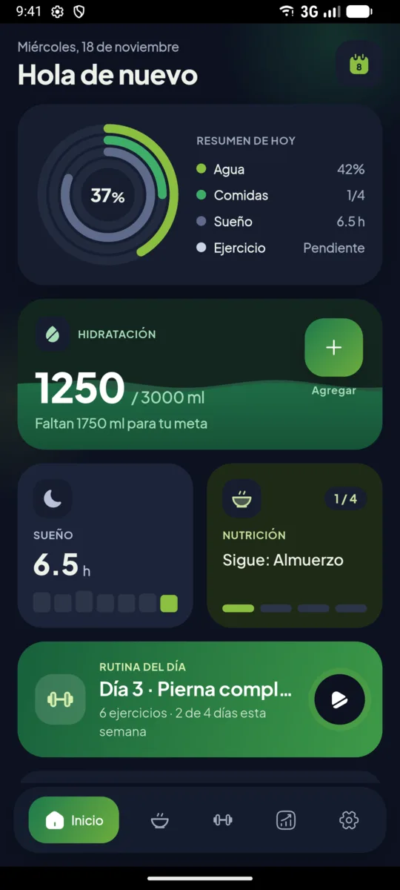
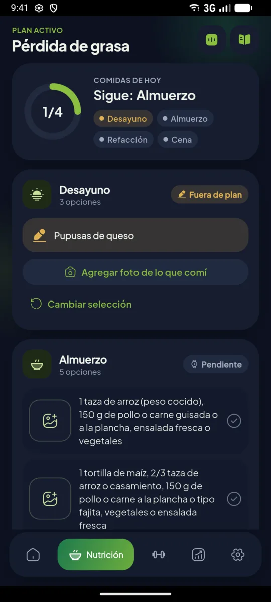
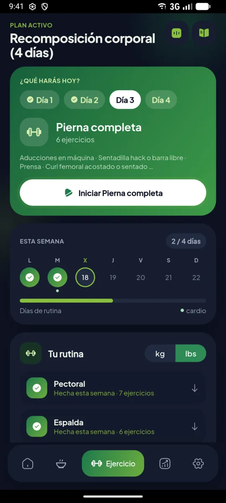
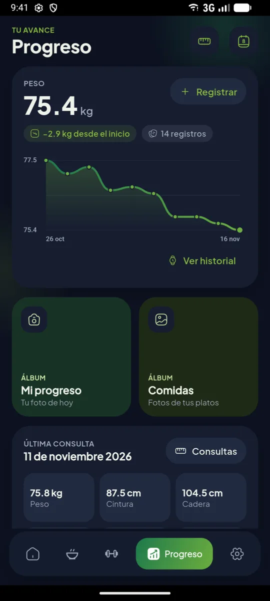

<div align="center">


# Kiolog

**Tu salud, un día a la vez.**

Bitácora personal de salud para Android: plan alimenticio, ejercicio, agua, sueño y medidas,<br>
con el reporte para tu nutricionista listo antes de cada consulta.


&nbsp;
&nbsp;
&nbsp;


<sub>Las capturas usan datos de demostración.</sub>

</div>

---

## 🌱 Por qué nació

Kiolog nació de una necesidad personal. Después de cada consulta, la nutricionista entrega un plan con varias opciones por tiempo de comida, una rutina de gimnasio y metas de agua y cardio. Entre una cita y la siguiente, todo eso quedaba repartido entre papeles, notas y fotos sueltas, y al llegar a la consulta era difícil contestar algo tan simple como *"¿cómo te fue con el plan este mes?"*.

Las apps de salud que existen están hechas para contar calorías, no para seguir **el plan que te dio tu nutricionista**. Kiolog parte de ese plan: te dice qué comida sigue, te deja marcar qué opción comiste (y también lo que comiste fuera del plan, sin culpas) y, al final del mes, arma un PDF con todo para compartirlo en la consulta.

Y como son datos de salud, se quedan en el teléfono: sin cuentas, sin servidores y sin depender de internet.

## ✨ Funciones

| | Módulo | Qué hace |
|:-:|---|---|
| 🥗 | **Nutrición** | El plan por tiempos de comida (desayuno, almuerzo, refacción y cena) con sus opciones. Registra la opción del plan, lo que comiste fuera del plan o "no seguí el plan", con foto del platillo. |
| 🏋️ | **Ejercicio** | Rutinas por día con series, rangos de repeticiones, pirámides, drop sets, notas del entrenador y un video o imagen de referencia por ejercicio. También registra cardio. Peso en kg o lb. |
| 💧 | **Agua** | Registro en ml o litros contra la meta diaria. |
| 🌙 | **Sueño** | Hora de dormir y de despertar, con varias tomas por día (siestas incluidas). |
| 📈 | **Progreso** | Gráfica de peso, medidas antropométricas de cada consulta, un álbum de comidas y un álbum diario de progreso (hasta 3 fotos o videos cortos por día). |
| 📅 | **Historial** | Vistas por mes y por día comparadas con tus metas, con días seguidos y días sobre el 70 %. |
| 🩺 | **Consultas** | Próxima cita con recordatorio la noche anterior y 2 horas antes. |
| 📄 | **Reporte PDF** | Cumplimiento, gráficas diarias, tabla semanal, calendario de ejercicio y cardio, registro diario y consultas. Listo para compartir con tu nutricionista. |
| 🏆 | **Logros** | Reconocimientos por tu constancia. |
| 💾 | **Respaldos** | Copia automática diaria en `Download/Kiolog` (guarda las últimas 7), más respaldo y restauración manual. |
| 🎨 | **A tu manera** | Cada módulo se enciende o apaga, y hay tres temas: Kiolog noche, Kiolog claro y Salvia. |

## 🔒 Privacidad

- 📵 **Sin cuentas ni servidores.** Todo vive en una base SQLite dentro del teléfono.
- ✈️ **Funciona sin internet.** El registro diario es completamente local.
- 🤝 **Tú decides qué compartir.** El reporte PDF sale solo cuando tú lo compartes.

Lee la [política de privacidad](https://jesuszelayag.github.io/kiolog/privacidad.html) completa.

## ⚕️ Aviso médico

> [!IMPORTANT]
> Kiolog es una bitácora personal. **No es un dispositivo médico** y no diagnostica, trata ni previene ninguna condición de salud. La información que registras y los reportes que genera no sustituyen la valoración ni las indicaciones de tu nutricionista, médico u otro profesional de la salud. Consulta siempre a un profesional antes de cambiar tu alimentación, tu actividad física o cualquier tratamiento.

## 🛠️ Stack

| Capa | Tecnología |
|---|---|
| Framework | Flutter (Android primero) |
| Estado | `flutter_bloc` |
| Base de datos | Drift sobre SQLite (schema v19) |
| Inyección de dependencias y navegación | `get_it`, `go_router` |
| Notificaciones | `flutter_local_notifications` |
| PDF y compartir | `pdf`, `share_plus` |
| Multimedia | `image_picker`, `video_player`, `youtube_player_iframe` |

La arquitectura sigue BLoC con capas por feature (`data/`, `domain/`, `presentation/`):

```
lib/
├── core/        # base de datos, DAOs, DI, router, tema, notificaciones
├── features/    # nutrition, exercise, water, sleep, progress, history,
│                # reports, achievements, onboarding, settings, home
└── shared/      # widgets compartidos
site/            # página del proyecto (GitHub Pages)
docs/superpowers # especificaciones y planes de diseño
```

## 🚀 Desarrollo

Requisitos: Flutter 3.47 o superior y el SDK de Android.

```bash
flutter pub get
dart run build_runner build --delete-conflicting-outputs   # genera el código de Drift
flutter test
```

Compilar e instalar en un teléfono arm64:

```bash
flutter build apk --profile --target-platform android-arm64
adb install -r build/app/outputs/flutter-apk/app-profile.apk
```

> [!WARNING]
> No instales en el teléfono una versión con un schema más viejo que el que ya tiene. Antes de instalar, respalda la base:
> ```bash
> adb exec-out run-as com.kiolog.kiolog cat app_flutter/kiolog.sqlite > kiolog-backup.sqlite
> ```

## 📜 Licencia

Kiolog es software libre bajo la [Licencia Apache 2.0](LICENSE). Puedes usarlo, modificarlo y distribuirlo, también con fines comerciales, siempre que conserves el aviso de copyright y el archivo [NOTICE](NOTICE).

El software se entrega **"tal cual"**, sin garantías de ningún tipo, y el autor no responde por daños derivados de su uso (secciones 7 y 8 de la licencia).

**Nombre y logo:** el nombre "Kiolog" y su logo no están cubiertos por la licencia (sección 6). Si haces un fork o una versión derivada, usa otro nombre y otro logo.

Copyright © 2026 Jesús Zelaya.

---

<div align="center">
<sub>Hecho con 💚 y Flutter · <a href="https://jesuszelayag.github.io/kiolog/">jesuszelayag.github.io/kiolog</a></sub>
</div>
